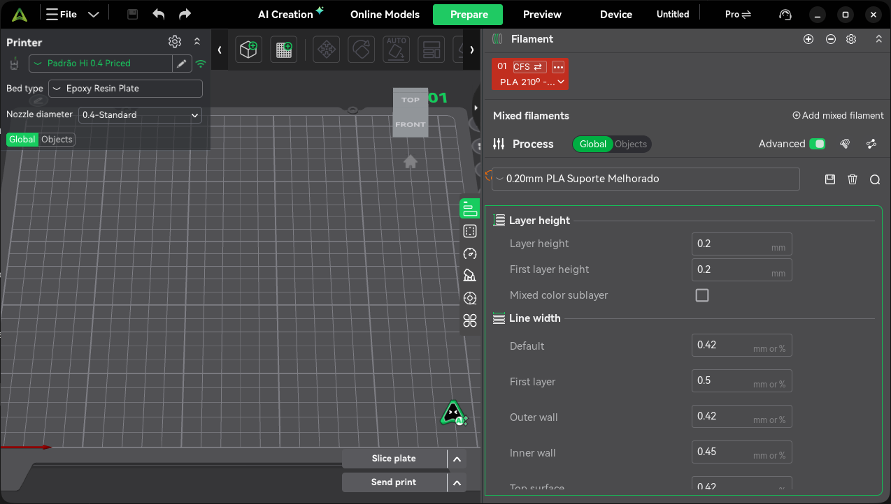
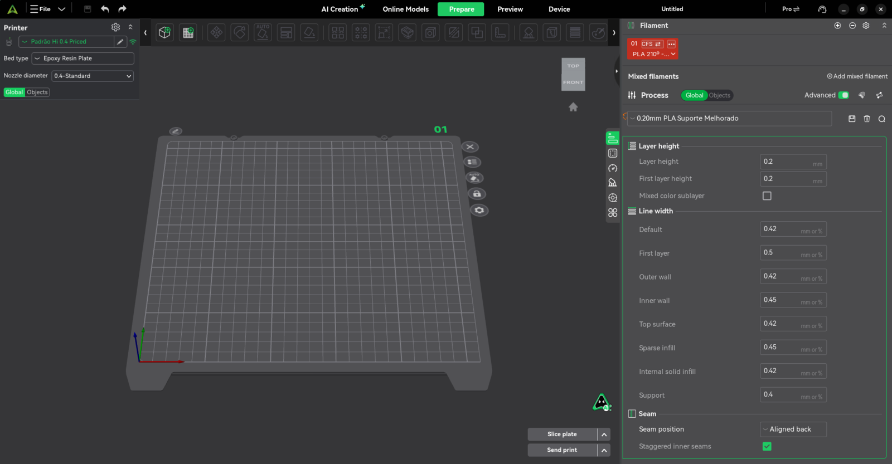
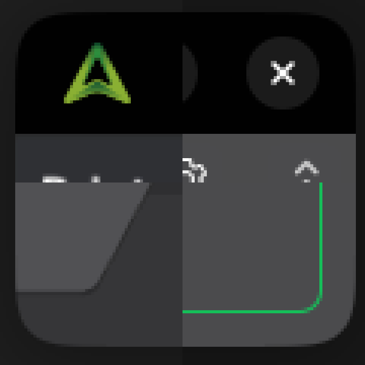
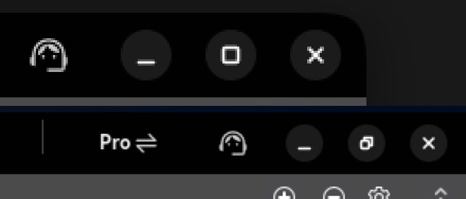

# Correções no CrealityPrint 7.3.1 (Linux / Flatpak)

As correções estão no branch `fix/linux-gnome-and-project-presets` deste fork, sobre a versão 7.3.1 (a mesma do Flatpak instalado). Este branch (`linux-dev`) parte dele e acrescenta só o que é de uso local: este documento, o script `flatpak/build-fedora.sh` e o `resources/printers/version.txt`. Compilado como Flatpak e testado no GNOME 50 (Wayland). Os problemas 1 a 6 foram confirmados por você; o 7 tem as capturas abaixo.

| # | Problema | Situação |
|---|---|---|
| 1 | Tema escuro indisponível no Linux/Flatpak | Corrigido |
| 2 | Ao reabrir um projeto, impressora, processo e filamentos voltam aos padrões (Hyper PLA/PETG, 0.20mm Standard) | Corrigido (causa encontrada com `letreiro-feliz-natal.3mf`) |
| 3 | Campo "Multiplier" dos volumes de purga não aparece | Provável correção (diálogo cortado no GTK) |
| 4 | Pré-visualização mostra só o custo do filamento, sem a hora-máquina | Corrigido |
| 5 | Ctrl+C/Ctrl+V em objetos só funciona depois de vários cliques | Corrigido |
| 6 | Impressão por objeto recusa uma peça baixa impressa antes de uma alta, por "colisão" | Corrigido |
| 7 | Barra superior e bordas fora do padrão GNOME | Corrigido: botões de janela e cantos arredondados no estilo libadwaita (Wayland) |

## 1. Tema escuro

No Linux, o modo escuro seguia o tema do sistema. Dentro do Flatpak, o tema GTK é o Adwaita claro, qualquer que seja o do desktop. Resultado: a interface ficava sempre clara, e as páginas web (início, comunidade), que leem a opção `dark_color_mode`, ficavam escuras. A opção "Enable Dark mode" das Preferências só existia no Windows.

- `GUI_App::dark_mode()` no Linux passa a usar a opção das Preferências, como no Windows. O padrão já é escuro.
- A inicialização no Linux deixa de sobrescrever essa opção com o tema do sistema.
- A opção "Enable Dark mode" aparece nas Preferências também no Linux.
- Os widgets nativos do GTK (menus, diálogos de arquivo) recebem `gtk-application-prefer-dark-theme`, na inicialização e ao mudar a opção.
- Ao mudar a opção, aparece um aviso para reiniciar: a maior parte dos painéis escolhe as cores quando é criada.

Arquivos: `src/slic3r/GUI/GUI_App.cpp`, `src/slic3r/GUI/Preferences.cpp`.

## 2. Presets perdidos ao reabrir o projeto

Ao abrir `letreiro-feliz-natal.3mf`, a impressora aparecia como "Padrão Hi 0.4 Priced (letreiro-feliz-natal.3mf)", o processo como "Default Setting" e o filamento como "Default Filament". O projeto guarda os nomes certos, e os valores que você personalizou são idênticos aos dos seus presets locais.

**Causa:** o perfil de sistema "Creality Hi 0.4 nozzle" vem com um `print_host` preenchido (`http://172.23.209.71:4408/`, um IP interno da Creality). Os seus presets de impressora herdam esse valor. Ao carregar um projeto, os campos de conexão nunca são lidos dele (`load_external_preset` os deixa no padrão, vazios). Na comparação entre o preset do projeto e o seu, o host diferia, e o CrealityPrint concluía que a impressora era outra. Então criava a cópia "(projeto.3mf)", e o processo e os filamentos não se encaixavam nela.

**Correções** (`src/libslic3r/Preset.cpp`):
- os campos de conexão (`print_host`, `printhost_*`) não contam mais na comparação entre o preset do projeto e o local, porque não afetam o fatiamento;
- se existe um preset de impressora local com o nome do projeto, mas com valores diferentes, ele é selecionado e as diferenças aparecem como alterações não salvas, como já acontecia com processo e filamento. Antes, o CrealityPrint criava a cópia "<nome> (<projeto>.3mf)".

**Diagnóstico:** durante a investigação, logs `[PROJECT_PRESET]` no nível `warning` mostravam cada decisão de `load_external_preset` e o que estava selecionado em cada etapa do carregamento no `Plater`. Eles foram retirados do branch do PR e guardados em [`diagnostico-project-preset.patch`](diagnostico-project-preset.patch). Se algum preset voltar a se perder, aplique o patch na raiz do repositório com `git apply notas-linux/diagnostico-project-preset.patch`, recompile e procure `[PROJECT_PRESET]` no log.

Projetos salvos enquanto o problema existia podem ter nomes como "PETG 245º - Padrão R$70,00(grinch_natal.3mf)" (é o caso de `grinch_natal_c_cadeira.3mf`). Esses nomes não existem localmente, então o preset do projeto continua sendo usado. Para corrigir, escolha o seu preset de novo e salve o projeto.

## 3. Multiplier dos volumes de purga

O campo existe (`WipingPanel`, na última linha da página de volumes), mas o diálogo não era redimensionável e calculava a altura antes de o GTK saber a altura real das caixas de texto. A última linha, com o Multiplier, podia ficar fora da janela. Agora o diálogo é redimensionável e, no GTK, recalcula o tamanho depois de exibido.

**Não confirmado:** se o campo continuar sumido, mande um print do diálogo.

Arquivo: `src/slic3r/GUI/WipeTowerDialog.cpp`.

## 4. Custo da hora-máquina

A opção "Time cost" (preço por hora) existe nas configurações da impressora, mas nenhum cálculo a usava. Agora a pré-visualização mostra:
- no resumo: "Machine Cost" e "Total Cost" ao lado de "Material Cost";
- na legenda por filamento: "Machine Cost" e "Total Cost" abaixo de "Cost";
- no resumo de todas as placas: o custo total já soma a máquina, e o material e a máquina aparecem separados abaixo.

O custo da máquina é o preço por hora vezes o tempo estimado (modo normal). As linhas só aparecem quando o preço por hora é maior que zero. O custo do filamento (`total_cost`) continua igual, então o G-code e a exportação não mudam.

Arquivo: `src/slic3r/GUI/GCodeRenderer/BaseRenderer.cpp`.

## 5. Ctrl+C / Ctrl+V

A lista de objetos é desenhada com ImGui dentro da área 3D. Depois de um clique nela, o ImGui reivindicava o teclado (`WantCaptureKeyboard`), e o `GLCanvas3D::on_char` descartava a tecla antes de chegar ao atalho de copiar. Só um clique em outro ponto da placa devolvia o teclado. Agora Ctrl+C, Ctrl+V e Ctrl+X passam sempre, a não ser que um campo de texto esteja em edição.

Arquivo: `src/slic3r/GUI/GLCanvas3D.cpp`.

## 6. Colisão na impressão por objeto

A checagem expandia cada objeto pelo raio de folga do extrusor e recusava qualquer par que se tocasse, sem considerar a ordem nem a altura. Na impressão por objeto, a ordem é a da lista de objetos. Enquanto o objeto posterior é impresso, o corpo do hotend fica `nozzle_height` acima da ponta do bico, então passa por cima de um objeto anterior mais baixo que isso. É o caso da chapa de 1 mm impressa antes do vaso.

Agora, se o objeto impresso antes é mais baixo que `nozzle_height`, o par só precisa manter os bicos afastados. Essa é a mesma distância que o slicer já usava quando todos os objetos são baixos. As checagens de altura (barra e tampa) continuam iguais.

Atenção à ordem: se a peça alta estiver antes na lista, o aviso continua aparecendo, e com razão.

Arquivo: `src/libslic3r/Print.cpp`.

## 7. Botões da janela e cantos no estilo GNOME

No Wayland, a janela principal não tem barra de título do sistema: a barra superior do CrealityPrint desenha os próprios botões de minimizar, maximizar e fechar. Eles usavam ícones no estilo Windows, com uma moldura verde no hover, e a janela tinha cantos retos. Eram as duas coisas que denunciavam o app como estranho ao GNOME.

- **Botões** (`src/slic3r/GUI/BBLTopbar.cpp`): desenhados como os do libadwaita. São círculos de 24 px preenchidos com a cor do texto a 10% (15% no hover, 30% ao clicar), com ícones simbólicos desenhados no código. Quais botões aparecem, e em que ordem, vem da configuração do GNOME (`gtk-decoration-layout`, que o GTK lê pelo portal, então funciona no Flatpak). Com a configuração padrão do GNOME, só o "fechar" aparece. Com a sua (`minimize,maximize,close`), os três. O ícone de maximizar vira o de restaurar quando a janela está maximizada.
- **Cantos** (`src/slic3r/GUI/MainFrame.cpp`, `src/slic3r/GUI/GLCanvas3D.cpp`): raio de 12 px, o das janelas libadwaita, quando a janela não está maximizada, encaixada na lateral nem em tela cheia. Nesses casos ela fica reta, como no GNOME. A parte desenhada pelo GTK é recortada com uma máscara antisserrilhada depois de pintada. A vista 3D é uma superfície OpenGL separada e zera os próprios pixels fora do arco quando ocupa um canto da janela.
- O Windows e o X11 não mudam.

Evidências, tiradas no GNOME 50 (Wayland) com o build instalado:

| Janela normal | Maximizada |
|---|---|
|  |  |

Cantos ampliados (superior esquerdo e direito, inferior esquerdo, que é da vista 3D, e inferior direito):



Botões ampliados, com a janela normal (em cima) e maximizada, com o ícone de restaurar (embaixo):



## Como compilar

O CrealityPrint 7.3 não compila direto no Fedora 45, porque pede o `webkit2gtk-4.0`, que o Fedora removeu. O build usa o Flatpak do repositório (GNOME SDK 50, Clang 21):

```bash
./flatpak/build-fedora.sh
```

Ajustes feitos no manifesto (`flatpak/io.github.crealityofficial.CrealityPrint.yml`):
- versão 7.3.1 em vez de 6.0.0, para o app usar a mesma pasta de configuração (`Creality Print/7.3`) e os seus presets;
- 4 jobs de compilação (`--jobs`), para não faltar memória;
- o módulo das dependências recebe só `deps/` e `cmake/`, para uma mudança no código não recompilar todas as dependências;
- o `env` do módulo do app foi movido para `build-options`, onde o flatpak-builder o lê;
- o `run_gettext.sh` é chamado com `bash`, porque o arquivo não tem permissão de execução no repositório.

**Arquivo que faltava no código-fonte:** o `.gitignore` do repositório ignora qualquer `version.txt`, e o `resources/printers/version.txt` ficou de fora. Sem ele, o primeiro build fechava ao abrir com `Could not parse version string:`. O arquivo foi recriado com `01.08.03.01`, a mesma versão da sua configuração, e está versionado neste branch (com `git add -f`, por causa do `.gitignore`). O `PresetUpdater` também deixou de fechar o app quando esse arquivo falta (`src/slic3r/Utils/PresetUpdater.cpp`).

O resultado é um bundle em `~/.cache/crealityprint-flatpak/CrealityPrint-dev.flatpak`, que **não** é instalado automaticamente. Ele tem o mesmo ID do Flatpak que você usa, então instalar substitui o atual:

```bash
flatpak install --user ~/.cache/crealityprint-flatpak/CrealityPrint-dev.flatpak
```

O que foi instalado no sistema para isso está em [instalado-no-sistema.md](instalado-no-sistema.md).
