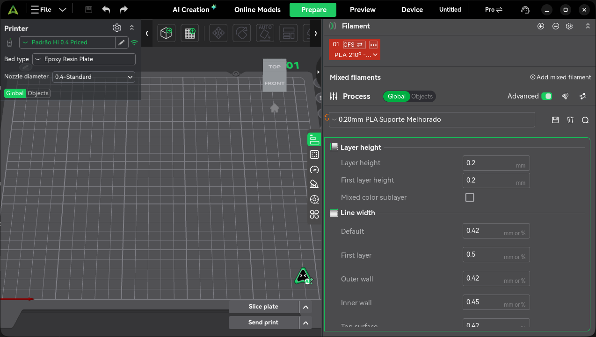
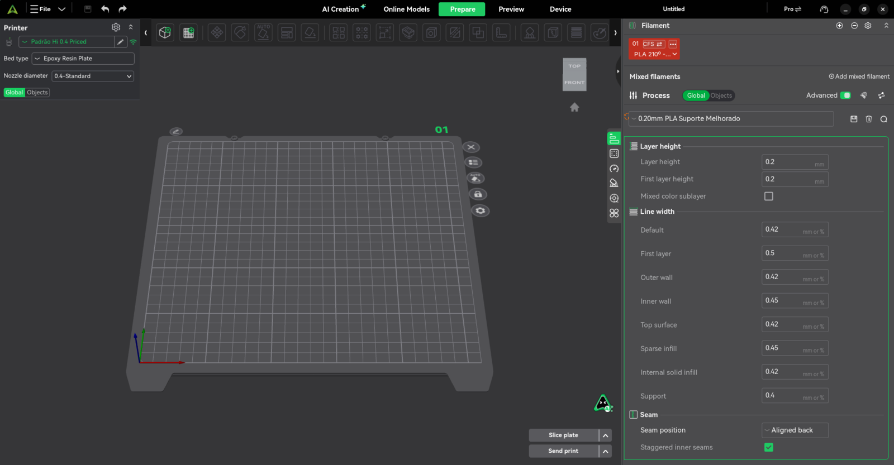
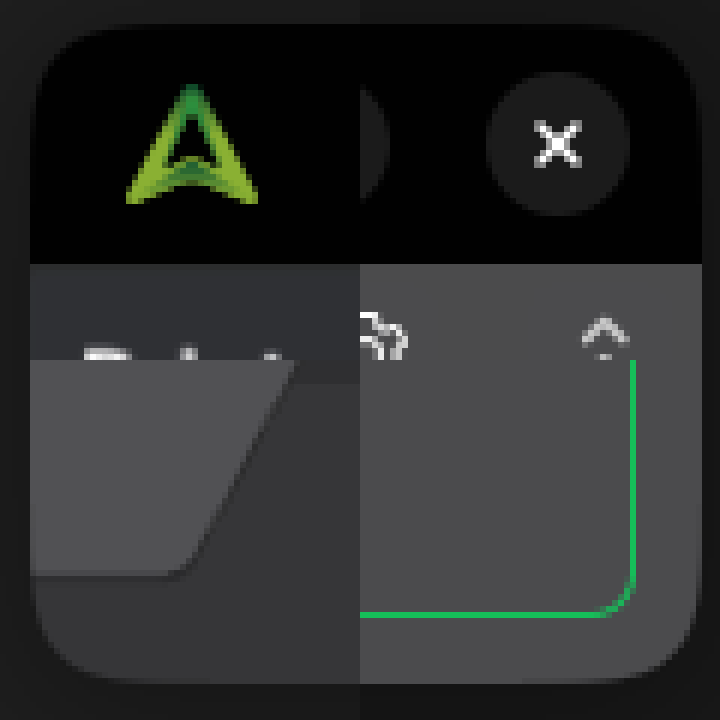
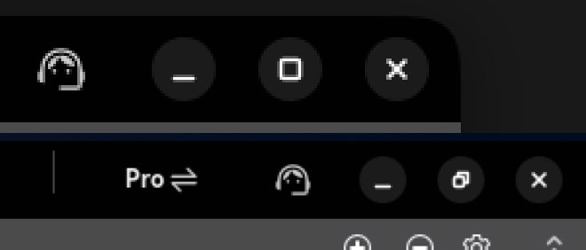
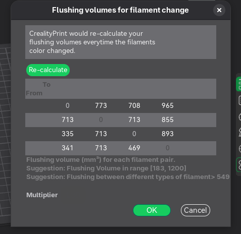
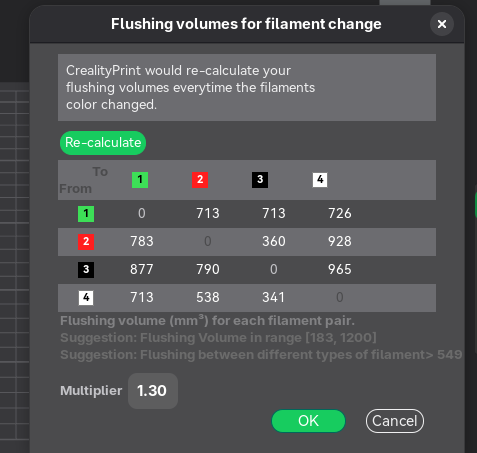

# Description

Fixes for problems found while using CrealityPrint 7.3.1 daily on Fedora 45 (GNOME 50, Wayland, Flatpak) with a Creality Hi + CFS. Each item lists the cause and the change. Windows and macOS behaviour is unchanged except where noted (items 1, 4, 5, 8 and 10 are cross-platform fixes).

The branch is merged with the current `master` (`sync: update sources from release-261130 after v7.3.1`); the one conflict, in `WipeTowerDialog.cpp`, is described in item 3.

### 1. Reopening a project loses the printer, process and filament presets
After saving a project with user presets and opening it again, the printer came back as a new `Padrão Hi 0.4 Priced (project.3mf)` preset, the process as `Default Setting` and the filaments as `Default Filament`, although the saved values were identical to the local presets.

- **Cause:** `load_external_preset()` never takes connection settings from a project (they stay at their defaults), but the system `Creality Hi 0.4 nozzle` profile ships a `print_host` (`http://172.23.209.71:4408/`), which user printers inherit. `profile_print_params_same()` therefore always found a difference, so the printer was loaded as a project copy, and the process and filaments then fell back to defaults.
- **Fix** (`src/libslic3r/Preset.cpp`): connection settings (`print_host`, `print_host_webui`, `printhost_*`) are ignored by `profile_print_params_same()`, since they do not affect slicing. A local printer preset with the project's name is now selected, with any differing project values applied as unsaved changes, as print and filament presets already were, instead of creating a `<name> (<project>.3mf)` copy.

### 2. Dark mode not available on Linux / Flatpak
On Linux `GUI_App::dark_mode()` followed the system theme, but inside the Flatpak the sandbox's GTK theme is always the light Adwaita, so the UI stayed light while the web pages (which read `dark_color_mode`) were dark. The Preferences option was Windows-only.

- **Fix** (`GUI_App.cpp`, `Preferences.cpp`): on Linux the "Enable Dark mode" option is shown and respected (it already defaults to dark), startup no longer overwrites it, and native GTK widgets get `gtk-application-prefer-dark-theme`. Changing it shows a restart notice, since most panels pick their colours when built.

### 3. Flushing volumes dialog: Multiplier value and filament colour icons not drawn
The Multiplier row and the colour icons of the matrix header and first column were laid out but not drawn on GTK.

- **Cause (icons):** they were small `wxButton`s. GTK's theme gives a button about 20 px of padding and border, so a 16 px button has no room for its image (`Negative content width -4 … owner GtkButton`) and the image is never drawn. The 20 px buttons that `master` now uses are exactly that padding and border, so their image still gets no room.
- **Cause (Multiplier):** the text box kept the theme's text colour. With a dark GTK theme that is `#FFFFFF`, which the dialog's dark-mode pass (`UpdateDarkUI`) maps as a window background to `#4B4B4D`, the dialog's own grey.
- **Fix** (`WipeTowerDialog.cpp`, `WipeTowerDialog.hpp`): the icons are `wxStaticBitmap`s (nothing handled clicks on them). The merge keeps `master`'s 20 px size and `set_wiping_color_bitmap()` drawing; the function takes a `wxStaticBitmap` and no longer calls `SetBitmapMargins()`, which only buttons have. The Multiplier box sets its text colour like the matrix boxes already do. Both causes were reproduced with wxWidgets 3.3.2 on GTK 3.24 (Adwaita dark) in a minimal program, including 20 px buttons.

### 4. Machine cost missing from the G-code preview
The printer option "Time cost" (per hour) existed but nothing used it; the preview only showed the filament cost.

- **Fix** (`GCodeRenderer/BaseRenderer.cpp`): the preview summary and the filament legend show "Machine Cost" (hourly rate x estimated time) and "Total Cost", and the all-plates summary adds the machine cost to its total. Shown only when the rate is above zero. `total_cost` (filament) and the G-code output are unchanged.

### 5. Ctrl+C / Ctrl+V and Delete on objects only work after several clicks
- **Cause:** after a click in the ImGui object list, ImGui reports `WantCaptureKeyboard`, and `GLCanvas3D::on_char()` returned before the clipboard shortcuts and the Delete key were handled.
- **Fix** (`GLCanvas3D.cpp`): Ctrl+C/V/X and Delete (and Backspace on macOS, which the same handler treats as Delete) pass through unless an ImGui text field is being edited.

### 6. By-object printing refuses a short part printed before a tall one
A 1 mm plate printed first next to a tall vase was rejected as "too close to others", although the hotend passes over it.

- **Fix** (`Print.cpp`, `sequential_print_clearance_valid()`): objects print in object-list order. If the earlier object of a pair is lower than `nozzle_height`, the hotend body clears it while the later one prints, so the pair only needs the nozzle tips apart (the distance already used when all objects are short). The height checks are unchanged, and a tall object placed before a close one is still rejected.

### 7. Window controls and corners look foreign on GNOME (Wayland)
On Wayland the main window has no system title bar: the top bar draws its own minimize/maximize/close buttons (Windows-style icons with a green hover frame), and the window has square corners.

- **Fix** (`BBLTopbar.cpp`, `MainFrame.cpp`, `GLCanvas3D.cpp`, GTK/Wayland only): the buttons are drawn like libadwaita's (24 px circles filled with the text colour at 10/15/30 % for normal/hover/pressed, symbolic glyphs, restore glyph when maximized), shown in the order and set given by `gtk-decoration-layout` (GNOME's button layout, read through the settings portal, so it works in the Flatpak). The window gets libadwaita's 12 px rounded corners unless maximized, tiled or fullscreen: GTK-drawn content is masked after it paints (with a transparent window background so GTK does not declare the surface opaque), and the OpenGL canvas clears its own pixels outside the arc where it fills a window corner.

### 8. A stray orange arrow behind the preset combo
In the sidebar's process tab, an orange arrow showed behind the left edge of the preset combo, and stayed there when the real undo arrow on the right disappeared.

- **Cause:** `Tab.cpp` defines `DISABLE_UNDO_SYS`, so the "undo to system value" button is created, given a bitmap and a tooltip, but never added to the top sizer or hidden. It sits at its panel's top-left corner. The filament and printer tabs also leave the "undo" button out of their sizer, and showed it again when the search box closed.
- **Fix** (`Tab.cpp`): buttons that are not laid out are hidden, and the filament and printer tabs no longer show their unplaced undo button after a search.

### 9. The object list's context menu closes unless the right button is held
- **Cause:** the ImGui object list opened its context menu as soon as the right button went down. On GTK a popup menu opened while the button that opened it is still pressed closes when that button is released.
- **Fix** (`GUI_ObjectList.cpp`, `GUI_ObjectList.hpp`, GTK only): the menu opens when the right button is released over the item, as the 3D scene's menu already does (on right-up). Selection still happens on press. Other platforms keep opening it on press.

### 10. Modified settings pages are not marked in the page list
The preset name shows `*` when a filament has unsaved changes, but in the filament settings dialog no page (Filament, Cooling, Setting Overrides, …) was marked, so finding the change meant opening every page.

- **Cause:** `update_changed_tree_ui()` colours the pages that hold modified values, but returns at once while the tab's page list has no items. The list is built only when the tab is first shown (`request_page_tree_rebuild()`), so for a preset loaded with changes, for example from a project, the colours were worked out before the list existed, and the list was then built with the default colours.
- **Fix** (`Tab.cpp`): `rebuild_page_tree()` works the colours out again once the items exist.

### 11. Robustness and Flatpak build
- `PresetUpdater.cpp`: a missing or unreadable `resources/printers/version.txt` no longer aborts startup. Assigning the empty string to `Version::config_version` went through Semver's throwing constructor; the file is ignored by `.gitignore`, so builds from a clean checkout crashed with `Could not parse version string:`.
- `flatpak/io.github.crealityofficial.CrealityPrint.yml`: builds 7.3.1 (so it uses the same `Creality Print/7.3` data folder as the release); the dependency module's ninja takes the `--jobs` value and only receives `deps/` and `cmake/`, so source changes no longer invalidate its cache; the app module's `env` moved under `build-options`, where flatpak-builder reads it; and `run_gettext.sh` is run through `bash`, since it is not executable in the repository.

No breaking changes or new dependencies.

# Screenshots/Recordings/Graphs

GNOME 50, Wayland, Flatpak build of this branch.

| Windowed | Maximized |
|---|---|
|  |  |

Corners zoomed (top-left, top-right, bottom-left, which is the OpenGL canvas, and bottom-right):

Window controls zoomed: windowed (top) and maximized with the restore glyph (bottom):

Flushing volumes dialog in dark mode, before and after item 3 (both taken before the merge with `master`, so with the earlier 16 px icons):

| Before | After |
|---|---|
|  |  |

## Tests

Built with the repository's Flatpak manifest (GNOME SDK 50, Clang 21) on Fedora 45 and used on GNOME 50 (Wayland) with a Creality Hi:

- **Presets:** opened a project saved with user printer/process/filament presets. Printer `Padrão Hi 0.4 Priced`, process `0.20mm PLA Suporte Melhorado` and filament `PLA 210º - Padrão R$100,00` were all selected after loading. Before the fix: a `(project.3mf)` printer copy, `Default Setting` and `Default Filament`. The tested build also logged each preset decision while diagnosing this; those log lines are not part of this PR.
- **Dark mode:** toggled in Preferences, restarted, and confirmed the UI and native menus/dialogs follow it.
- **Flushing volumes:** the filament colour icons appear in the header and first column, and the Multiplier value is visible and editable in dark mode (screenshots above).
- **Machine cost:** sliced with "Time cost" set; the preview shows machine and total cost.
- **Clipboard and Delete:** clicked an object in the object list and used Ctrl+C / Ctrl+V and Delete right away. Delete inside the rename field still edits the text.
- **Sequential clearance:** a 1 mm part listed before a tall vase within the extruder clearance radius now slices.
- **Undo arrow:** the stray arrow behind the process preset combo is gone; the undo arrow on the right still appears when a value is changed.
- **Context menu:** right-click on an object and on a plate in the object list; the menu stays open after the button is released and its actions work.
- **Page list:** opened the filament settings dialog for a filament with unsaved changes; the pages that hold them are highlighted.
- **Startup:** the crash was reproduced on the first build (no `version.txt`, `Could not parse version string:` from `get_printer_config_updates()`); the tested build ships the file, so the new guard itself was not exercised.
- **GNOME look:** see the screenshots above. Windowed: rounded corners on all four sides, including the OpenGL corner. Maximized: square corners and the restore glyph. Not tested on X11 or Windows, where this code is not compiled or not active.
- **After the merge with `master`:** the merged branch was built with the same Flatpak manifest, and the fixes above were checked again.

🤖 Generated with [Claude Code](https://claude.com/claude-code)
